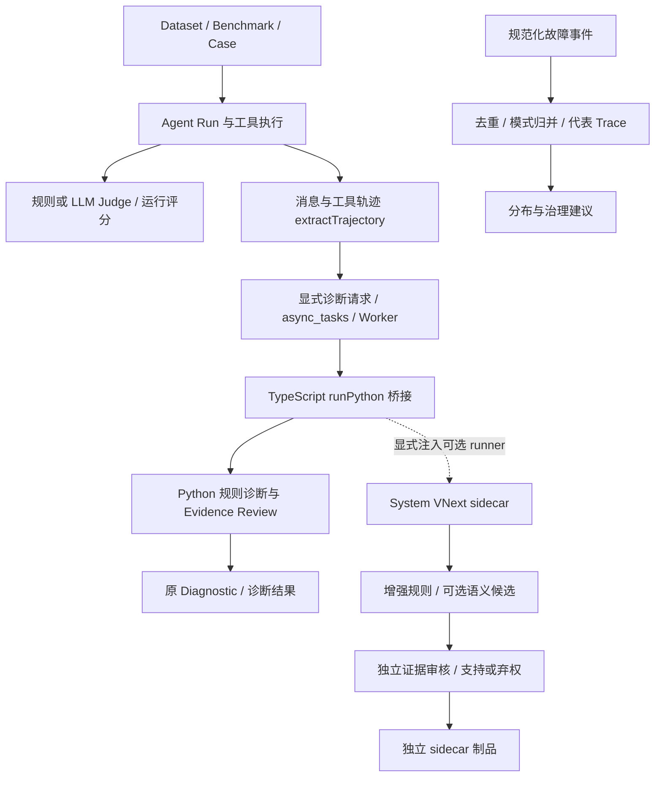

# Agent Eval · 轨迹评测与故障归因

面向 LLM Agent 多步执行过程的评测与诊断工程：从 Dataset / Benchmark / Case 发起运行，将工具调用、消息和评分组织为可追溯轨迹，再通过规则诊断、结构化候选与独立证据审核，定位值得排查的失败现象。

重点关注三个问题：**任务是否成功、轨迹中实际发生了什么、现有证据足以支持哪一层结论。** 系统区分局部异常、最终任务失败与因果根因，并保留证据不足时的弃权结果。

基于既有 Agent 平台和归因脚本进行复现、集成验证与增量研究。完整平台、历史快照、修复记录、实验数据和学习材料一起保留；当前源码入口见下文，不以整个上游平台作为原创成果。

## 仓库结构

```text
agent-eval-project/
├── platform/                   # 完整 Web / Agent 平台，包含自身 packages 和 tests
├── diagnostics/                # Python sidecar、证据审核、归并与离线测试
├── experiments/
│   ├── postgres-acceptance/     # PostgreSQL 联调与 40 例离线对照
│   ├── model-smoke/             # 最新真实模型开发实验与原始结果
│   └── model-smoke-v1/          # 最新实验依赖的前序输入与共享账本
├── docs/                       # 文档、教材与离线 study-pack
├── source-reference/           # 参考脚本与来源材料
└── scripts/                    # 从仓库根运行的统一检查与演示入口
```

从根目录执行 `python -B scripts/check.py` 可运行三组离线检查；`python -B scripts/demo.py` 输出一份 Mock sidecar 结果。两条命令不启动数据库、不调用外部模型。

## 快速体验

先体验仅依赖 **Python 3.10+ 标准库**的 System VNext 离线诊断，无需模型 Key、GPU 或数据库：

```bash
git clone https://github.com/lhuowang681-cpu/agent-eval-project.git
cd agent-eval-project/diagnostics
python -B -m unittest test_review test_system
python -B sidecar.py < results/demo-input.json
```

Windows PowerShell 的最后一步改为：

```powershell
Get-Content results/demo-input.json -Raw | python -B sidecar.py
```

测试覆盖证据引用、来源隔离、局部支持与根因区分、默认关闭、Provider 预算与超时、恢复轨迹、事件去重和失败模式归并。本次 README 更新时重新执行，**14 项通过**。命令中的 demo 使用显式 Mock 候选，不发起付费模型请求。

完整 Web 平台需要另行安装 Node / pnpm、Python 依赖和 PostgreSQL，并配置环境；仓库没有携带 node_modules、数据库或真实密钥。平台锁定 `pnpm@10.33.4`，部分历史依赖使用本机 stubs，换机运行仍需适配。步骤见[历史平台演示说明](https://github.com/lhuowang681-cpu/agent-eval-project/tree/archive/2026-11-27-before-layout/local_checks/2026-11-08_phase2/DEMO.md)和[真实数据库联调说明](experiments/postgres-acceptance/README.md)。

## 实际执行链路



主平台使用 **Next.js、React、TypeScript、tRPC、Drizzle ORM、PostgreSQL**；诊断与审核使用 Python。新增 sidecar 通过 runner 扩展隔离，原评分、Judge 与 Run 结果保持原链路；事件归并是独立分析入口。

## 核心能力

| 模块 | 实际行为 | 关键边界 |
| --- | --- | --- |
| 评测运行 | 管理 Dataset / Case、Judge 配置、Run 与执行消息 | Mock、真实数据库和真实模型结果分别记录 |
| 轨迹提取 | 将平台消息和工具调用转换为诊断输入，保留 Run / Case / Thread 身份与 inputDigest | 不借用其他任务的证据 |
| 异步诊断 | 显式入队，由独立 Worker 调用 Python，查询诊断与轨迹 | 请求入队不等于已经完成分析 |
| 规则诊断 | 从结构化错误、工具结果与执行上下文提取异常观察 | 局部错误不自动升级为最终失败根因 |
| Evidence Review | 核验 node、字段、原文引用、来源范围及结论支持程度 | 引用存在、语义支持和因果成立分别判断 |
| 语义 Shadow | 可选 Provider 生成结构化候选，独立审核后输出 sidecar | 默认关闭，调用数、Token 和超时受限 |
| 归并与优先级 | 去重事件、区分失败模式、选择代表 Trace 并给出治理建议 | 区分典型严重度与最坏情况，不将频次等同于根因 |

## 验证与实验结果

以下是仓库中各轮报告的记录，**不同阶段的测试和样本不累加成统一成绩**。本次发布仅重跑上述 14 项 Python 测试和离线 demo，没有重跑全平台、数据库或真实模型实验。

| 范围 | 已有记录 | 证据 |
| --- | --- | --- |
| 平台第二阶段回归 | 945 项去重通过，属于当轮历史回归 | [历史回归汇总](https://github.com/lhuowang681-cpu/agent-eval-project/tree/archive/2026-11-27-before-layout/local_checks/2026-11-08_phase2/REGRESSION_SUMMARY.json) |
| 后续评分与归因 TS 子树 | 225 / 225，通过范围为 21 个文件 | [联调回归报告](experiments/postgres-acceptance/REGRESSION_REPORT.md) |
| 真实 PostgreSQL / tRPC / Worker | 11 个场景通过，含 2 个通过轨迹的策略跳过 | [数据库端到端报告](experiments/postgres-acceptance/POSTGRES_E2E_REPORT.md) |
| System VNext Python | 14 项通过；本次命令再次验证通过 | [原测试总账](diagnostics/TEST_AND_REGRESSION_REPORT.md) |
| 真实模型开发 Smoke | 累计 6 次请求、4 个不同 Trace，保留失败和 Prompt 迭代 | [真实模型结果](experiments/model-smoke/RESULTS.md) |

### 40 例离线对照

下面是单作者合成结构集合上的**确定性增强规则与审核实验**。候选由规则生成，不能将其解释为 LLM 的准确率或独立泛化能力。

| 方法 | 正确观察 / 输出观察 | Recall | 正常 / 恢复误报 |
| --- | --- | --- | --- |
| 原 Python 规则 | 10 / 13 | 10 / 27 | 3 / 14 |
| 原规则 + 增强规则候选 | 25 / 28 | 25 / 27 | 3 / 14 |
| 同一候选 + Evidence Review | 25 / 25 | 25 / 27 | 0 / 14 |

审核在这个集合中过滤了 3 条错误观察，没有丢弃已有正确候选；另外 2 条漏检仍未解决。集合没有已证实的因果根因正例，根因 Accuracy / Recall 为 NA。数据协议和逐项解释见[离线对照](experiments/postgres-acceptance/BASELINE_SHADOW_COMPARISON.md)与[数据集协议](experiments/postgres-acceptance/DATASET_PROTOCOL.md)。

真实模型的 6 次开发请求中，v3 的 3 次输出结构有效，包含 1 个受支持的答案矛盾观察；该观察也能被增强规则发现，**尚未证明 LLM 相对增强规则的独有增量**。40 例正式真实模型实验未运行，Shadow 保持默认关闭。参见[最新结果与决定](experiments/model-smoke/RESULTS.md)。

## 源码导航

仓库保留多轮冻结快照，建议从以下当前入口阅读：

| 位置 | 内容 |
| --- | --- |
| [`platform/`](platform/) | 完整平台工作副本；前端、服务、数据库模型与测试 |
| [`platform/src/server/services/agentEvalAttribution/`](platform/src/server/services/agentEvalAttribution/) | 诊断服务、轨迹提取、TypeScript / Python 桥接与合同 |
| [`platform/scripts/eval-attribution/`](platform/scripts/eval-attribution/) | 平台已接入的 Python 规则与证据审核 |
| [`diagnostics/`](diagnostics/) | sidecar、分层审核、Provider 约束、事件归并与测试 |
| [`experiments/postgres-acceptance/`](experiments/postgres-acceptance/) | 真实 PG 联调、ModelRuntime 适配、40 例数据与离线对照 |
| [`experiments/model-smoke/`](experiments/model-smoke/) | 真实模型 Smoke、版本化 Prompt、原始脱敏输出与负结果 |
| [`source-reference/`](source-reference/) | 原始参考脚本、运行时选段与历史分析 |
| [`docs/study-pack/index.html`](docs/study-pack/index.html)、[`docs/book/`](docs/book/) | 下载后可离线打开的学习材料与工程教材 |

## 设计取舍与当前限制

- **候选生成与事实审核分开。** 模型输出先作为候选，必须通过身份、原文和结论支持检查；结构合法也不等于因果成立。
- **保留原产品链路。** Shadow 用独立 runner / sidecar 承载，可通过不注入 runner 或 `enabled=false` 关闭，不自动改写原评分与诊断 Schema。
- **允许弃权。** 恢复中的异常、业务字段里的历史错误、局部证据不足，均不能自动归为最终任务失败根因。
- **复现范围明确。** 仓库包含历史绝对路径和依赖兼容层；全库 TypeScript 检查仍有历史诊断，完整环境不保证 clone 后直接启动。报告中的分层通过不等于全平台全绿。
- **模型价值仍在验证。** 小规模真实调用证明了部分输出合同可以工作，尚未完成独立人工质量集、正式真实模型对照或生产推广验收。

## 来源、许可与归档

本仓库包含上游平台、参考脚本和后续实验，不对所有目录统一声明原创或重新授予许可。请查看对应目录的许可证与来源说明，包括[平台许可证](platform/LICENSE)和[参考来源清单](SOURCE_MANIFEST.json)。

历史完整交付、原路径校验清单、早期实验及两份平台基线保存在[整理前归档](https://github.com/lhuowang681-cpu/agent-eval-project/tree/archive/2026-11-27-before-layout)。当前主分支只保留一份完整平台和最新诊断/实验入口；目录对应关系与复现限制见[仓库结构说明](docs/REPOSITORY_LAYOUT.md)。

相关项目：[Job Agent · 长期求职与代码面试工作台](https://github.com/lhuowang681-cpu/stateful-job-agent)。
