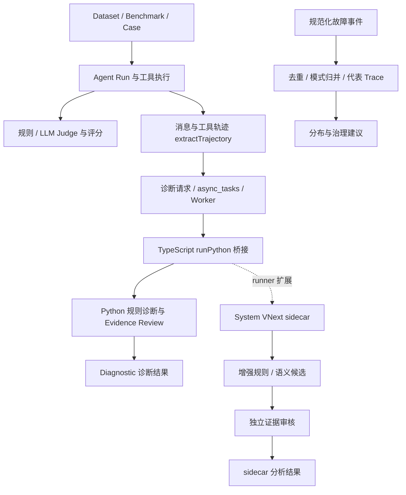

# Agent Eval · 轨迹评测与故障归因

面向 LLM Agent 多步执行过程的评测与诊断系统，覆盖 **评测运行 → 轨迹提取 → 异步诊断 → 证据审核 → 故障归并**，将一次任务的评分、工具调用、异常现象和引用证据连接起来。

项目围绕既有 Agent 平台完成诊断链路集成，并实现 System VNext sidecar、分层证据审核、ModelRuntime 适配和故障模式分析，配套 PostgreSQL 联调、40 例合成数据对照和真实模型开发实验。

## 核心能力

| 模块 | 实现内容 |
| --- | --- |
| 评测运行 | Dataset / Benchmark / Case 管理、Judge 配置、Run 执行与结果汇总 |
| 轨迹提取 | 整理消息和工具调用，保留 Run / Case / Thread 身份、节点引用与 inputDigest |
| 异步诊断 | 通过 async_tasks 入队，Worker 调用 Python 分析，支持诊断结果与轨迹查询 |
| 规则诊断 | 结合结构化错误、工具返回和执行上下文，提取故障观察 |
| Evidence Review | 核验节点、字段、原文引用和任务范围，分别判断局部支持与因果支持 |
| 语义 Shadow | 通过 ModelRuntime 生成结构化候选，由独立审核器处理，使用调用数、Token 和超时预算 |
| 归并与优先级 | 事件去重、失败模式归并、代表 Trace 选择、严重度分布与治理建议 |

## 系统架构



平台使用 **Next.js、React、TypeScript、tRPC、Drizzle ORM、PostgreSQL**；规则诊断、证据审核和事件归并使用 **Python**。sidecar 通过 runner 扩展接入，独立记录分析结果。

## 快速体验

Python 3.10+ 标准库即可运行离线检查和合成数据演示：

```bash
git clone https://github.com/lhuowang681-cpu/agent-eval-project.git
cd agent-eval-project
python -B scripts/check.py
python -B scripts/demo.py
```

`check.py` 运行三组测试，共 **24 项**：14 项 sidecar 测试、4 项指标测试和 6 项模型结果离线断言。`demo.py` 使用合成轨迹与 Mock 候选，输出结构化诊断和引用证据。

完整 Web 平台使用 Node / pnpm、Python 和 PostgreSQL，包管理器版本为 `pnpm@10.33.4`。环境配置和联调步骤见[数据库实验入口](experiments/postgres-acceptance/README.md)与[平台演示记录](https://github.com/lhuowang681-cpu/agent-eval-project/blob/archive/2026-11-27-before-layout/local_checks/2026-11-08_phase2/DEMO.md)。

## 验证与实验结果

| 验证项目 | 结果 | 记录 |
| --- | --- | --- |
| 平台第二阶段回归 | 945 项去重测试通过 | [回归汇总](https://github.com/lhuowang681-cpu/agent-eval-project/blob/archive/2026-11-27-before-layout/local_checks/2026-11-08_phase2/REGRESSION_SUMMARY.json) |
| 评分与归因 TypeScript 子树 | 21 个文件，225 / 225 项通过 | [联调回归报告](experiments/postgres-acceptance/REGRESSION_REPORT.md) |
| PostgreSQL / tRPC / Worker 联调 | 11 个场景通过，覆盖诊断链路与通过轨迹的策略跳过 | [数据库报告](experiments/postgres-acceptance/POSTGRES_E2E_REPORT.md) |
| 仓库离线检查 | 24 项通过 | [检查入口](scripts/check.py) |
| 真实模型开发实验 | 6 次请求、4 个不同 Trace，记录三个 Prompt 版本的输出与审核结果 | [模型实验结果](experiments/model-smoke/RESULTS.md) |

### 40 例合成数据：增强规则与证据审核

在同一组 40 例合成轨迹上，对比原规则、增强规则候选和独立审核三种处理流程：

| 方法 | 正确观察 / 输出观察 | Recall | 正常 / 恢复误报 |
| --- | --- | --- | --- |
| 原 Python 规则 | 10 / 13 | 10 / 27 | 3 / 14 |
| 原规则 + 增强规则候选 | 25 / 28 | 25 / 27 | 3 / 14 |
| 同一候选 + Evidence Review | 25 / 25 | 25 / 27 | 0 / 14 |

Evidence Review 过滤了 3 条错误观察，保留 25 条正确观察，将正常 / 恢复轨迹上的误报从 3 条降至 0 条。实验数据、逐例输出和计算口径见[对照报告](experiments/postgres-acceptance/BASELINE_SHADOW_COMPARISON.md)与[数据集协议](experiments/postgres-acceptance/DATASET_PROTOCOL.md)。

### 真实模型：结构化输出与审核

完成 6 次真实模型开发请求，对比 v1、v2、v3 三个 Prompt 版本。v3 的 3 次请求均通过输出结构校验，覆盖答案矛盾识别、正常轨迹和状态更新后的恢复轨迹。每次请求保存原始脱敏响应、Token、延迟、规则对照和证据审核结果，见[实验分析](experiments/model-smoke/RESULTS.md)。

## 关键设计

- **候选生成与证据审核分层**：Provider 负责生成结构化候选，审核器验证身份、引用原文和结论支持程度。
- **任务范围与证据身份绑定**：通过 Run / Case / Thread、节点 ID 和 inputDigest 关联轨迹与诊断结果。
- **诊断链路模块化**：使用异步 Worker 与 Python 桥接执行分析，sidecar 通过 runner 扩展接入。
- **故障分析保留上下文**：分别记录局部异常、恢复过程、最终任务结果与因果支持等级。
- **实验可追溯**：保存数据协议、版本化 Prompt、冻结快照、逐例结果和执行记录。

## 仓库结构与源码导航

```text
agent-eval-project/
├── platform/                   # Web / Agent 平台、评测服务与数据库模型
├── diagnostics/                # Python sidecar、证据审核、故障归并与测试
├── experiments/
│   ├── postgres-acceptance/     # 数据库联调与 40 例合成数据对照
│   ├── model-smoke/             # 真实模型开发实验与分析
│   └── model-smoke-v1/          # 前序输入、接口校验与共享调用账本
├── docs/                       # 文档、工程教材与离线学习包
├── source-reference/           # 参考脚本与运行时材料
└── scripts/                    # 统一检查与演示入口
```

| 阅读入口 | 内容 |
| --- | --- |
| [诊断服务](platform/src/server/services/agentEvalAttribution/) | 轨迹提取、诊断调度、TypeScript / Python 桥接与数据合同 |
| [平台 Python 分析](platform/scripts/eval-attribution/) | 规则诊断与证据审核 |
| [System VNext](diagnostics/README.md) | sidecar、Provider、证据审核与事件归并 |
| [实验索引](experiments/README.md) | 数据库、合成数据和真实模型实验 |
| [文档导航](docs/README.md) | 架构说明、路径索引与学习资料 |

## 来源与归档

平台及参考代码的来源和许可证见[平台许可证](platform/LICENSE)与[参考来源清单](SOURCE_MANIFEST.json)。早期实验、完整平台基线和原路径校验清单保存在[整理前归档](https://github.com/lhuowang681-cpu/agent-eval-project/tree/archive/2026-11-27-before-layout)，目录对应关系见[仓库结构说明](docs/REPOSITORY_LAYOUT.md)。

相关项目：[Job Agent · 长期求职与代码面试工作台](https://github.com/lhuowang681-cpu/stateful-job-agent)。
