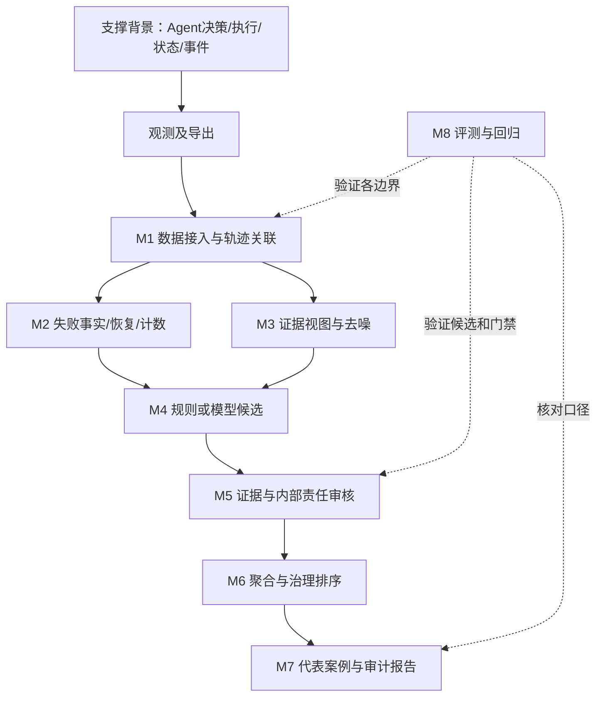

# 项目全景地图

## 业务与研究问题

业务人员只看到“查询失败”，开发人员需要区分：哪里明确失败、异常输入从哪里来、是否存在内部可改进机制、证据是否足够、影响了多少不同任务。输入为Langfuse拉取/缓存、JSONL或工作簿导出的执行记录；输出为分类行、审计链、优先级及代表Case/CSV/Excel/图表。

核心问题是“从嘈杂的多步骤记录形成可验证、可行动的诊断”，因此采用评测归因研究问题主线，并非以搭一个聊天网页为主。朴素起点是关键词候选＋人工核对，最终目标是事实、候选、证据审核、统计与报告分层。

## 全景职责图

图是8项核心分析职责，不是声称当前恰有8个独立目录。M5有规范、部分校验和启发式门禁，严格独立审核仍有缺口；M8只有来源报告/教学方案，当前无完整个人归因评测实现。平台作为P0背景，不计入8项主模块，也不要求重建整个企业系统。

## 实际入口必须分开讲

- 模型路线：badcase_analysis.run_pipeline→langfuse_fetcher/缓存→有source_xlsx时trace_denoiser补充节点→llm_classifier→aggregator→visualizer/Case报告。offline不等于不调模型。
- 规则路线：structured_jsonl_attribution.scan→嵌套消息提取→调用映射→真实返回失败检测→来源与规则分类→分类文件→后续日报脚本。Provider output有单独错误契约分支。
- 多轮导出重建、日报渲染及代表Case选择不完全相同，不能拼成一条已经统一部署的流水线。工作簿模板是交付样式约束，不是算法准确性依据。

## 技术栈按实际作用分级

| 级别 | 技术/知识 | 项目中的作用与学习深度 |
| --- | --- | --- |
| A | 身份、调用配对、失败/恢复合同 | 决定分析对象、影响计数和业务状态；需原理、反例和关键实现 |
| A | 图式祖先与时间邻域、预算裁剪 | 构造归因证据视图；需解释最小证据组和丢失风险 |
| A | taxonomy、规则与LLM结构化候选 | 约束分类空间并解释能力边界；不等于训练模型 |
| A | 内外责任、反事实、三层证据门禁 | 决定结论可行动性；规范与实际阈值差距要深入 |
| A | 去重统计、多维排序、TF-IDF/medoid及层级选样 | 决定开发优先顺序和代表性；能解释公式目标及偏差 |
| A | 标注、基线、消融、误报/覆盖与审计 | 支撑真实改进结论；现有评测缺口需明确 |
| B | Python、JSON/JSONL、pandas、NumPy | 接入、规整、聚合、距离矩阵；理解数据流，不背所有API |
| B | TypeScript Brain/Runtime/Executor、Redis/PG/队列 | 被测对象背景；回填和控制信号的重要故障局部可深入为A |
| B | Langfuse及OpenAI兼容客户端 | 数据获取和模型请求适配；当前无企业连接/真实模型验证 |
| C | matplotlib、工作簿样式、普通CLI与目录配置 | 交付外围，知道用途；不逐行讲样板与配色 |

requirements列出langfuse/openai/pandas/matplotlib/dotenv/tqdm/numpy，但并未完整覆盖所有工作簿脚本依赖。它不是锁定环境，不能据此声称一键可跑。源码调用与导入才是使用证据；未发现此参考包中完整package.json/锁文件/业务测试工程。

## 前置与顺序

V0问题与基线→V1运行来源→V2身份关联→V3失败/恢复→V4证据视图→V5候选→V6门禁→V7排序→V8案例报告→V9评测串讲。V5的规则与模型为分支，V6汇合的是输出合同，不是假定旧脚本已经完成统一合流。

最小背景知识：工具调用、JSON对象、字典索引、基础统计。随当前需求补充，不把词汇表拆成大量独立课。V1只讲能解释轨迹来源的运行框架；租约、事务发件箱等通用扩展仅在确实影响本项目证据判断时提及。
