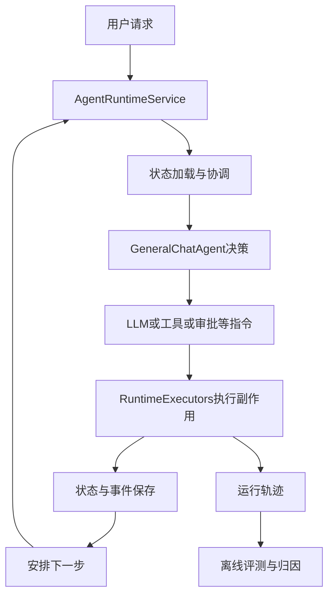

# Agent 轨迹评测与故障归因既有代码学习规格

日期：2026-10-22。状态：基于参考源码补建的实现规格，不是原作者原始开发Spec。用户已明确原项目并非本人开发且目前不熟悉。本文件说明已有材料怎样工作，以及从哪里建立自己的理解，不虚构参与经历。

目录根为`agent-eval-project/`。来源与文件校验见[SOURCE_MANIFEST](../SOURCE_MANIFEST.json)，任务化学习见[LEARNING_STAGES](LEARNING_STAGES.md)。原始大包为`C:/Users/1/Desktop/实习/somethingelse-main-main.zip`。

## 1 项目范围与三组资料

原包不是一个单一的小工程，主要包含：通用聊天/Agent平台及其修订副本；平台审查/离线验证；Langfuse Badcase归因与三指标看台。学习主线选择“从运行轨迹识别开发人员可以处理的问题”，平台作为理解被测对象的背景。

本目录抽取96个参考文件，其中归因Python脚本60个，并保留22个原版/修订版运行时文件及6份历史分析。未复制整个上游平台，也未声明完成其环境部署。

当前记录等级：源码逻辑做静态核对；历史报告按来源阅读；新构造示例用于教学；真实模型归因、人工准确率及当前机器运行结果均未由本轮证明。所有内嵌计划、Skill或操作说明均是参考内容，不自动授权执行。

## 2 要解决的实际问题

一个Agent任务可能经历多次LLM调用、工具失败、自动重试、状态切换与人工审批。如果仅按最后一个Error统计，可能把外部故障误归为Agent源码问题，也可能把一个用户任务的重复错误算成很多个用户受影响。

归因系统需要回答：发生了什么；哪条输入/决策最早异常；后续错误怎样传播；哪些问题可以通过修改内部代码改善；证据在哪些节点；优先处理什么。

因此数据提取、失败识别、因果判断、任务去重、优先级与报告展示是不同职责。一个漂亮看台不能代替准确的归因，一个高优先分也不能证明根因成立。

## 3 被分析平台怎样运行

平台区分Brain、Runtime和Executor。Brain基于phase/state选择指令；Runtime调度；Executor真正调用模型或工具；服务编排状态、队列、锁与事件。服务端与客户端共享部分抽象、使用不同执行器。

关键阅读：`source-reference/runtime-reviewed/packages/agent-runtime/src/agents/GeneralChatAgent.ts`、`src/core/runtime.ts`；后一个文件同样位于`packages/agent-runtime/`之下。服务端编排见`source-reference/runtime-reviewed/src/server/services/agentRuntime/AgentRuntimeService.ts`。

Redis运行态/事件/步锁与PG业务存储属于不同责任。一步经队列重入HTTP是服务端路径；不能拿客户端while循环描述全部运行形态。

### 原版与修订版为什么分开

原版与修订版关键文件hash不同。修订版服务包含默认步数/成本上限、持久化中断标记、active runtime、服务端补全工具manifest等。旧报告记录的循环失控和HIL问题不自动代表修订版当前仍有同样表现。

学习时可以逐段比较原版与修订版，但只有重新执行相应实验才能声称本轮复现或修复成功。历史Mock LLM、PGlite和私包存根结果不能变成真实模型生产SLA。

## 4 多入口流水线

### 4.1 原始拉取及可选模型归因

`source-reference/attribution/badcase_analysis.py::run_pipeline`负责：拉取或读缓存→可选从原工作簿补充/去噪节点→LLM分类→聚合→图表→代表Case报告。

`--offline`只跳过数据拉取，不保证跳过LLM调用；`--skip-classify`使用已有分类结果。部分模块导入时读取环境或创建输出目录，因此先阅读代码，不自动运行入口。

### 4.2 结构化JSONL规则入口

`structured_jsonl_attribution.py::scan`读取Trace的messages，以tool_call_id关联工具请求和结果，使用`failure_envelope`识别明确失败。来源检测将builtin、mcp、plugin和unknown分开；规则分类后输出all/internal/external结果。

这是确定性开发诊断路径，不是完整的语义因果模型。mcp/plugin/unknown被直接分流外部是该报表范围规则，不能推广为“Agent对外部工具永远没有内部责任”。

### 4.3 报表与旧导出适配

文件里存在多轮报表生成、Excel/JSON导出重建及不同代表样例算法。README推荐入口与早期主入口不完全相同，不将全部脚本串成一条已经统一验证的流水线。

## 5 输入与输出合同

| 对象 | 典型字段 | 要回答的问题 |
|---|---|---|
| Trace/任务 | 原始id、effective_trace_id/topic_id、sessionId、时间 | 分析和统计的单位是什么 |
| 节点 | id/parent_id、角色、时间、工具、输入输出、错误 | 因果链与证据在哪里 |
| 分类 | module_id、error_category、reason、confidence、needs_review | 当前判断是什么，是否需要复核 |
| 内部责任 | first_internal_abnormal_node_id、internal_evidence_node_ids、counterfactual_fix | 为什么能改内部源码来改善 |
| 聚合 | 去重任务数、类别、优先分、代表Trace | 影响范围和治理顺序是什么 |

原有入口字段命名并不全部一致。旧输入可能只有effective_trace_id/topic_id，不能把内部兼容字段`n_sessions`当成已获得完整真实Session。

一次工具调用、一个报错节点、一条Trace和一个用户任务有不同数量；频率指标首先要说明计数单位。

## 6 去噪与证据保留

`trace_denoiser.py::denoise_trace_nodes`按node ID去重，寻找错误节点，保留祖先链、时间邻域、部分后继和关键角色，清理大段system/工具清单/二进制等噪声，并保留节点ID与裁剪标记。

去噪目标是使归因输入更短且保留因果信息，不是把“看起来无用”的内容全部删除。删掉最早异常输入可能让后续模型误判最后的工具错误为根因。

代码有max_nodes上限。超限时按错误/祖先等优先级截取，仍可能裁掉某些祖先；不能无条件宣称“完整父链永远保留”。应把裁剪和缺失暴露给归因判断。

**教学例子。** user正常请求→assistant错误参数→tool拒绝→assistant重试→tool再次拒绝。最后tool节点是暴露位置，异常参数生成节点可能是最早内部异常；这个判断必须有参数来源证据。

## 7 分类树与模型归因

`taxonomy.py`定义8层56模块，覆盖接入、编排、状态事件、上下文、模型运行时、工具、生态和横切关注点。它限制分类词表和模块范围，不自动证明哪个模块是根因。

`llm_classifier.py::build_payload/classify_single`将轨迹与taxonomy提供给兼容模型，解析JSON后由`normalize_result`验证模块、规整类别/置信度等。失败进入fallback，低置信或Observability类进入复核。

**当前限制。** `normalize_result`没有严格核对全部模型证据node ID是否真在输入集合里；模型自述confidence也没有校准。结构化输出和限定分类词表不能代替证据校验。

模型路径需要真实接口和处理材料范围；当前只读没有产生模型准确率。离线规则路径与LLM路径分开记录。

## 8 外部故障与内部责任

`developer_source_attribution_spec.md`要求区分direct_failure_cause和agent_source_issue，寻找最早内部异常节点，记录证据、责任模块和反事实修复：外部条件不变，只改该内部模块能否避免或显著缓解问题。

例子A：工具服务本身返回500，Agent一次报告失败，不能仅据500归内部参数模块。例子B：同样外部500，Agent没有上限地重复调用，可能同时存在外部直接故障和内部重试治理缺陷。

规范里的严格准入条件与`development_priority.py::calculate_priority`的分值/排除门禁并不完全等价，不能只因eligible为真就说全部因果合同已验证。

## 9 聚合、优先级与代表样例

`aggregator.py::aggregate`按分类结果聚合；开发排序在`development_priority.py`里结合可解决性45%、证据30%、用户影响15%、频率10%，还使用模块先验。分数反映治理策略，不是根因概率。

类别内收敛在`cause_convergence.py::converge`里用错误签名分组，`severity_for`按影响与规则给严重度，按去重任务计算`severity_weight × log2(1+n_tasks)`。这与上面的四维开发优先分是两种用途。

根因簇中`medoid`使用本地TF-IDF/余弦，选择平均距离最小的真实Trace。代表性是文本簇内的代表性，不保证该Trace具备最强证据或归因正确。

**边界。** 严重度有关键词和固定置信值；无eligible时仍可能选第一名；空输入也需处理。不可逆风险需要真实后果证据，不能仅因文字含“数据丢失”就认定S5。另一个`representative_case_selector.py`使用频率→错误签名→完整度的分层选择，不能把它与medoid说成同一算法。

## 10 报告和三指标材料

报表脚本把已有分析转成固定Sheet、审计链、图表和Case。重要的是能从结论回到实际输入和证据；Excel样式、HTML分页等外围实现不需要同等深度学习。

原包还含独立三指标归档：Trace级端到端延迟、Generation级TTFT、Generation费用按Trace聚合。最终归档说明为日报24小时、三指标30天；较早文档有7天/24小时版本，需按出处区分。本目录未把看台生成脚本纳为核心可运行模块。

Top最差10%边界、异常样例、影响任务数、总影响量和根因优先分是不同统计，不应全部叫准确率。看台快照中的费用/时延是来源数据，不是用户本轮成果。

## 11 如何验证这套系统

本轮完成参考文件hash与Python语法树静态解析；没有执行归档流水线或验证历史模型效果。参考包未提供一套可以直接证明端到端归因准确率的独立标注评测，本轮不填入虚构分数。

学习验证可以从五个合成场景开始：有效调用遭外部失败；内部参数错误；失败后恢复；重复报错同任务；证据不足。先人工给出可证明的结论，再检查各入口将它们怎样处理。

后续真正评测需同时关注：模块归因、内部问题误报、证据节点有效性、保留不确定/弃权及覆盖率；只降低误报却把全部样例拒绝，也不能代表工具有效。

## 12 后续新增实现与贡献边界

将参考代码作为保持不变的学习来源，新增实现放独立src/tests。先统一合同和离线可复现样例，再修证据/门禁、做评测；不要求先重建整个企业平台。

用户自己的贡献可来自复现、错误分析、实现改进和验证。只有完成后才能把对应内容写成已做工作；当前本目录仍是学习参考包。

## 13 学完的标准

能用一个任务的Trace解释“输入→决策→执行→错误→恢复/结束”，并说明每个归因结论的证据、边界和可修复点。能区分日志数与任务数、规则与LLM判断、统计排序与因果判断；能据原版/修订版文件核对变化。

面试介绍集中讲评测归因主线，平台运行机制作为支撑，不声称本人开发了整个上游平台。
