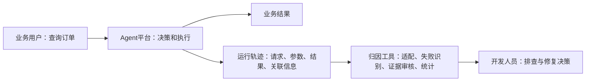

# A1 业务范围与首次理解检查

日期：2026-10-23。状态：本次A1验收完成，后续间隔复习待进行。下图由教练讲授并保存，用户通过下述两次回答说明业务范围和证据边界；不代表整个E01已掌握。可用时间60分钟，实际学习时长未记录。

归因工具的输入是运行记录，输出是可回查的失败分析报告，主要使用者是开发人员。平台与归因脚本来自参考材料；用户个人离线闭环尚未实现。当前学习业务边界，不重建整个企业平台。

## 实际问答

教练问题：订单日期参数完全合法，外部订单服务返回了500；Agent随后按约定停止，并提示服务暂时不可用。这时归因报告能不能写“Agent内部参数生成错误”？为什么？

用户原回答：

> 不能，因为参数本身是合法的，只是外部服务返回了500，虽然没办法保证参数没有在进入外部的时候被修改，但是也不能武断的说内部参数生成错误。

反馈：拒绝了缺乏证据的内部参数错误归因，并主动区分发出参数与实际接收参数，判断正确。题目已把参数合法设为前提，无须另设参数被修改；真实记录若仅包含发送端参数，则应核对传递与接收记录。收到500只能支持相应调用失败和服务端报错现象，具体根因仍可能需要更多证据；证据不足不等于内部所有环节已被排除。

本题只检查外部失败与内部责任的证据边界，不据此给整个E01评分，score=null。

## 第二次实际问答：使用者、输入与输出

教练问题：这个归因工具读什么数据，产出什么，能帮助你做什么？

用户原回答：

> 这个工具是给那些想测试自己搭建的agent哪里有问题的人提供的。会读取agent在工作过程中产生的一系列trace，根据这些trace来判断具体是哪里出现问题了，给出带有证据的意见，然后让被评测者进行优化

反馈：明确了面向Agent开发人员、读取运行Trace、输出带证据的意见用于改进，符合A1业务范围。表达可进一步收紧为“在可见证据范围内识别问题和内部改进候选，证据不足时待复核”，避免暗示一定能确定具体根因。未据此认定用户缺乏不确定性意识；第一题已体现其证据意识。score=null，不由两题推定整个E01的四维分数。

## A1验收记录

- 使用者、输入与输出：第二次回答支持。
- 工具失败不直接证明内部源码错误：第一次回答支持。
- 范围图与来源声明：本文件已保存，未将上游平台记作个人开发。
- 本次验收日期：2026-10-23。只完成A1，个人实现未开始；下一步A2身份与计数。

下次复习此边界：2026-10-24、2026-10-26、2026-10-30。日期是待复习安排，不代表届时已经完成。
