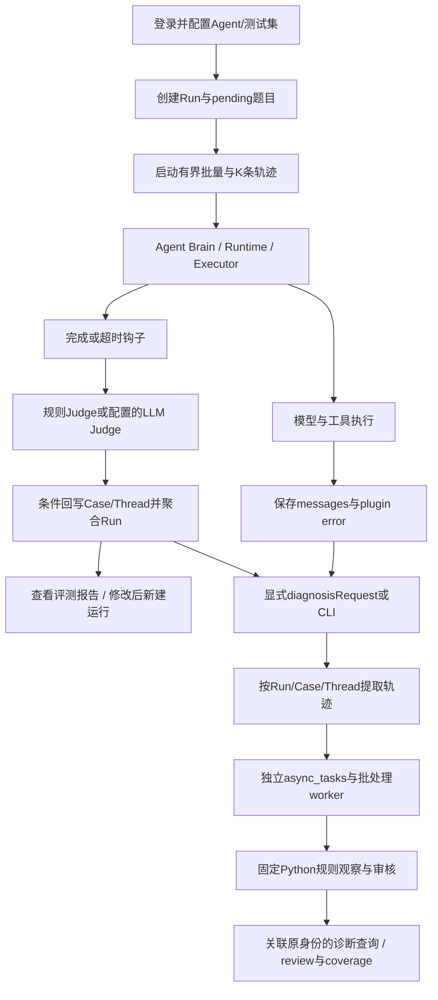
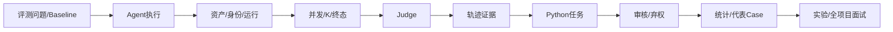

# 项目全景地图

## 项目究竟做什么

它面向开发和调试Agent的人：配置/选择被测Agent及测试题，执行任务并评分、查看结果，再对失败执行显式请求轨迹诊断，获得带原始身份、引文和审核状态的故障观察，辅助修改后重新评测。

它是**应用评测平台＋诊断研究的混合工程**。平台承载可配置Agent；Python诊断器分析执行记录；旧Langfuse/JSONL/Excel脚本是另外的分析路线。没有证据表明所有旧脚本已经统一成一个自动产品。

输入包括task、expected、rubric、Agent/provider/model配置和实际执行消息；输出包括Case分数/状态、Run指标、独立diagnosis/observations/review。当前能力重心是故障观察与保守审核，不是已经证明准确的内部根因定位。

当前执行主链读取平台自己保存的Agent配置；agentEvalExternal提供外部评分/诊断扩展，不能据此说“任意外部部署Agent都有通用自动接入协议”。这个范围和归因系统分析已有Trace的研究目标需要区分。

## 实际业务链路

文本替代：配置→创建→执行→保存→评分→报告→重测；诊断支线需显式请求并运行worker。当前没有自动把所有失败评分回调转成Python任务，也未新增完整的诊断专用UI。诊断API/CLI与评测结果页不是同一个已验证页面能力。

## 核心模块：8个教学职责

这8个模块是学习视角的职责拆解，不是8个独立部署服务。

| 模块 | 职责 | 关键证据 | 重点 |
| --- | --- | --- | --- |
| M1 评测资产与配置 | Benchmark/Dataset/Case、Run、Agent配置审计 | [P01](03_核心技术与源码证据.md#p01)；[P03](03_核心技术与源码证据.md#p03)；[P04](03_核心技术与源码证据.md#p04) | B；可复现边界为A |
| M2 执行编排与生命周期 | 启动、分页/并发、K线程、超时/取消、终态聚合 | [P02](03_核心技术与源码证据.md#p02)；[P09](03_核心技术与源码证据.md#p09)；[P11](03_核心技术与源码证据.md#p11)；[P16](03_核心技术与源码证据.md#p16)；[P17](03_核心技术与源码证据.md#p17) | A |
| M3 被测Agent运行时 | Brain→指令→Runtime/Executor→模型/工具→消息 | [P05](03_核心技术与源码证据.md#p05)；[P06](03_核心技术与源码证据.md#p06)；[P07](03_核心技术与源码证据.md#p07)；[P08](03_核心技术与源码证据.md#p08) | A；预算细节B |
| M4 规则与LLM评分 | 任务/标准上下文、加权、结构化分数、评分器错误 | [P12](03_核心技术与源码证据.md#p12)；[P13](03_核心技术与源码证据.md#p13)；[P14](03_核心技术与源码证据.md#p14)；[P15](03_核心技术与源码证据.md#p15) | A |
| M5 轨迹与证据合同 | Run/Case/Thread所属、原message、工具配对、coverage | [B02](03_核心技术与源码证据.md#b02)；[B03](03_核心技术与源码证据.md#b03) | A |
| M6 跨语言诊断任务 | 显式请求、async_tasks、固定Python进程、版本与lease | [B01](03_核心技术与源码证据.md#b01)；[B04](03_核心技术与源码证据.md#b04)；[B05](03_核心技术与源码证据.md#b05)；[B06](03_核心技术与源码证据.md#b06)；[B07](03_核心技术与源码证据.md#b07) | A |
| M7 故障观察与证据审核 | 失败封装、类别、存在性/支持性、根因边界与弃权 | [B07](03_核心技术与源码证据.md#b07)；[B08](03_核心技术与源码证据.md#b08)；[L04](03_核心技术与源码证据.md#l04)；[L05](03_核心技术与源码证据.md#l05) | A |
| M8 报告与质量研究 | 平台指标、旧离线排序/选样、独立标签与五组消融 | [P18](03_核心技术与源码证据.md#p18)；[L06](03_核心技术与源码证据.md#l06)；[L07](03_核心技术与源码证据.md#l07)；[L08](03_核心技术与源码证据.md#l08)；[L09](03_核心技术与源码证据.md#l09)；[L10](03_核心技术与源码证据.md#l10)；[L11](03_核心技术与源码证据.md#l11)；[R01](03_核心技术与源码证据.md#r01)；[R02](03_核心技术与源码证据.md#r02) | 质量A；旧报表B |

## 必须区分的三条路线

| 路线 | 输入/入口 | 实际产物及边界 |
| --- | --- | --- |
| 当前平台 | agentEval创建/运行/报告；agentEvalExternal诊断扩展 | Agent执行/评分闭环与独立Python观察；使用本机DB消息合同 |
| 旧模型分析 | badcase_analysis.run_pipeline | 拉取或缓存→可选去噪→LLM分类→聚合/报表；offline不保证不调用模型，未统一必经严格validator |
| 旧规则/报表 | structured_jsonl_attribution及多份日报/选样脚本 | 独立JSONL扫描及离线表格，不能自动挂到当前平台每个结果上 |

review_cli.safeCandidate是单独白名单输出；adapter主链即使review不支持仍保留规则诊断/观察并附复核标志。因此“实验完整审核组0安全输出”不等于“平台数据库0诊断记录”。

## 关键对象和状态

Benchmark组织标准，Dataset组织题目，Case定义输入/参考；Run是一次评测，RunTopic关联题目和执行Topic，K>1有eval Thread，operation标识运行操作，TraceID有时缺失，message/toolCallId用于定位事实。普通聊天Topic与评测Case不是同一概念。

Case的passed/failed是评分结论，error/timeout是执行或评分异常。Run的completed表示运行完成，不保证所有Case答对。诊断任务pending/processing/success/error属于另一生命周期；job success只说明分析器执行成功。needs_review/unknown不等于已证根因，也不等于没有业务问题。

配置快照是记录，不是执行冻结：createRun保存snapshot，execAgent重新读当前配置；不能由一个快照字段推出全实验可精确重放。

## 实际技术与学习价值

| 技术 | 实际用途/证据 | 学习等级与边界 |
| --- | --- | --- |
| TypeScript、Next.js/React、tRPC/Zod | 登录后评测界面及实际路由/schema；P02/B01 | B；重点追数据流，不讲完整通用工作空间UI |
| PostgreSQL、Drizzle；测试中PGlite | 表关系、user作用域、条件写和原任务表；P01/P16/B05 | B基础，终态/幂等A；组件用PGlite不冒充真实PG |
| AgentRuntime/GeneralChatAgent | 按phase产指令、执行模型/工具；P06/P07 | A；这是项目实际抽象，不包装成新造大模型 |
| 原ModelRuntime结构化调用、AbortController/硬截止 | LLM Judge；P14/P15 | A；真实模型质量仍未知 |
| tokenx与记录usage | token预算估算、65%默认触发；P08 | B；不是已证最优参数、不是证据去噪 |
| Python标准库子进程＋JSON合同 | 当前桥接/固定审核；B03/B06/B07 | A；主链不新增Python常驻服务或分布式队列 |
| 旧pandas/规则、TF-IDF与余弦medoid | 旧离线表格/代表样例；L07/L08 | B；不称当前RAG向量数据库或已优化的代表算法 |
| Vitest、Python unittest、固定候选五组回放 | 工程与质量分开验证；R01/R02、09实验卡 | A；Mock和合成标签不证明模型效果 |

未把仓库依赖中的所有语音、多模态、向量检索或分布式组件列成本项目教学核心；有入口/调用才讨论实际使用。

## 学习依赖

首轮顺序依业务生长，不按文件夹排序。A级深入专题在对应V完成后按薄弱处补，不在V0灌入所有技术。
