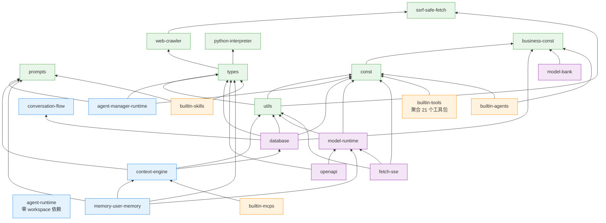
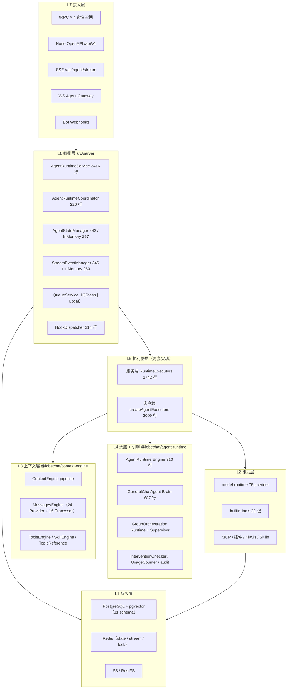

# 阶段 2 · 架构模块拆解

> 只读静态分析。基线 `main` @ `94dd700`。

## 0. 两把钥匙

理解这个项目只需要抓住两个设计决策，其余都是它们的推论：

1. **双运行时**：同一个 Agent 大脑（`GeneralChatAgent`）和同一个执行引擎（`AgentRuntime`）**同时跑在服务端和浏览器/桌面端**，只替换 executor 实现。
2. **单步 = 一次 HTTP 请求**：服务端 agent 循环不是长驻进程，而是「队列投一条消息 → 打到 `/api/agent/run` → 执行一步 → 再投下一条」，状态存 Redis。

---

## 1. 模块划分与依赖关系

### 1.1 workspace 包依赖图

`packages/` 下 63 个包。下图只画 `dependencies` + `peerDependencies` 中的 workspace 依赖（`devDependencies` 已剔除，因此能真实反映运行时耦合）。



**最重要的一条**：`packages/agent-runtime/package.json` 的 `dependencies` **只有 `p-map`**，`@lobechat/types`、`@lobechat/context-engine`、`openai` 全在 `devDependencies`。这是「大脑层零 IO」在依赖层面的硬约束。

### 1.2 工具包依赖

`builtin-tools` 聚合 21 个 `builtin-tool-*` 包：

| 依赖对象 | 依赖它的工具包 |
| --- | --- |
| `prompts` | `agent-builder`、`calculator`、`knowledge-base`、`lobe-agent`、`memory`、`notebook`、`remote-device`、`task`、`web-browsing` |
| `const` | `agent-builder`、`group-management`、`lobe-agent`、`skills` |
| `agent-manager-runtime` | `agent-builder`、`agent-management`、`group-agent-builder` |
| `electron-client-ipc` | `local-system`（桌面端 IPC） |
| `memory-user-memory` | `memory` |
| `editor-runtime` | `page-agent` |
| `builtin-tool-agent-builder` | `group-agent-builder` |

零依赖的工具包（可独立测试）：`activator`、`agent-documents`、`brief`、`cloud-sandbox`、`skill-store`、`tools`、`topic-reference`。

### 1.3 应用层目录职责

| 目录 | 职责 |
| --- | --- |
| `src/app/(backend)/` | Next.js 路由层，薄适配：解析请求 → 调 service → 包装响应 |
| `src/server/routers/` | tRPC router 定义（4 个命名空间） |
| `src/server/services/` | 业务服务层（`agentRuntime`、`aiAgent`、`aiChat`、`agentEvalRun`、`bot`、`gateway`、`queue`、`comfyui` 等） |
| `src/server/modules/` | 基础设施模块（`AgentRuntime`、`Mecha`、`ModelRuntime`、`S3`、`KeyVaultsEncrypt`、`AgentTracing` 等） |
| `src/store/` | 客户端 Zustand store（29 个 store）——**含客户端 agent 运行时** |
| `src/services/` | 客户端 service（含 `agentRuntime/client.ts` 的 SSE 客户端） |
| `src/features/` / `src/routes/` / `src/spa/` | SPA 前端（roots vs features 分层） |
| `src/business/` | 云版商业逻辑；本 fork 中 lambda-routers 多为空壳 |

---

## 2. 分层职责



| 层 | 职责 | 边界约定 | 违反点 |
| --- | --- | --- | --- |
| **L4 大脑/引擎** | 纯决策 + 指令派发。给定 `(phase, state)` 返回指令数组 | 零 IO、零 DB、零网络；仅依赖 `p-map` | 无 |
| **L5 执行器** | 把指令变成副作用 | 两套实现互不感知，靠 `InstructionExecutor` 签名对齐 | 服务端/客户端逻辑有重复（如 compress_context 各写一遍） |
| **L6 编排** | 状态持久化、调度、锁、钩子、webhook、tracing | — | `AgentRuntimeService` 2416 行，职责过载 |
| **L3 上下文** | 消息 → LLM payload 的确定性变换 | Pipeline 顺序敏感 | `context-engine` 依赖 `database`，纯度被打破 |
| **L2 能力** | provider / tool 归一化 | 通过 manifest + `toolSourceMap` 解耦 | — |
| **L1 持久** | PG 存业务实体；Redis 存运行态（TTL 2h）；S3 存文件 | Redis 不可用时按配置降级内存 | 运行态无 PG 兜底 |

---

## 3. 关键抽象

### 3.1 Brain / Engine 分离

```ts
// packages/agent-runtime/src/types/instruction.ts:69-113
interface Agent {
  runner: (context: AgentRuntimeContext, state: AgentState)
            => Promise<AgentInstruction | AgentInstruction[]>;
  executors?: Partial<Record<AgentInstruction['type'], any>>;
  modelRuntime?: (payload: unknown) => AsyncIterable<any>;
  calculateUsage?: (...) => Usage;
  calculateCost?: (context: CostCalculationContext) => Cost;
  tools?: ToolRegistry;
}
```

**13 种指令**（`instruction.ts:354-367`）：

| 指令 | 载荷要点 |
| --- | --- |
| `call_llm` | 任意 payload（messages/model/tools） |
| `call_tool` | `{parentMessageId, toolCalling: ChatToolPayload}` |
| `call_tools_batch` | `{parentMessageId, toolsCalling: ChatToolPayload[]}` |
| `exec_task` / `exec_tasks` | `{parentMessageId, task(s): ExecTaskItem}`（服务端执行） |
| `exec_client_task` / `exec_client_tasks` | 同上（桌面端本地执行，需 `runInClient: true`） |
| `request_human_prompt` | `{prompt, reason?, metadata?}` |
| `request_human_select` | `{options[{label,value}], multi?, prompt?}` |
| `request_human_approve` | `{pendingToolsCalling, skipCreateToolMessage?}` |
| `resolve_aborted_tools` | `{parentMessageId, toolsCalling, reason?}` |
| `compress_context` | `{messages, currentTokenCount, existingSummary?}` |
| `finish` | `{reason: FinishReason, reasonDetail?}` |

**15 种事件**（`event.ts:115-138`）：`init` / `llm_start` / `llm_stream` / `llm_result` / `tool_pending` / `tool_result` / `done` / `error` / `human_approve_required` / `human_prompt_required` / `human_select_required` / `interrupted` / `resumed` / `compression_complete` / `compression_error`。

**10 种终止原因**（`FinishReason`）：`completed`、`user_requested`、`user_aborted`、`max_steps_exceeded`、`max_steps_completed`、`cost_limit_exceeded`、`timeout`、`agent_decision`、`error_recovery`、`system_shutdown`。

### 3.2 Phase 驱动的状态机

`AgentRuntimeContext.phase`（`instruction.ts:32-44`）共 12 个取值：

```
init → user_input → llm_result ─┬→ tool_result / tools_batch_result → llm_result
                                ├→ task_result / tasks_batch_result → llm_result
                                ├→ human_response / human_approved_tool → …
                                ├→ compression_result → llm_result
                                └→ (no tool_calls) → finish
        human_abort ─→ resolve_aborted_tools
        error ─→ finish(error_recovery)
```

`GeneralChatAgent.runner` 就是这张表的实现（`GeneralChatAgent.ts` 类注释 30-40 行给出了简化版）。

### 3.3 AgentState —— 可序列化的「护照」

`packages/agent-runtime/src/types/state.ts:24-155`，7 个状态：

```
idle → running ⇄ waiting_for_human
              ⇄ waiting_for_async_tool
              → done | error | interrupted
```

`isBlockedStatus()`（`utils/status.ts`）用于在指令数组执行中途 break。

字段分组：

| 组 | 字段 |
| --- | --- |
| 核心上下文 | `messages`、`systemRole`、`operationId` |
| 状态机 | `status`、`stepCount`、`maxSteps`、`forceFinish` |
| 工具 | `tools`、`toolManifestMap`、`toolSourceMap`、`operationToolSet`、`activatedStepTools`、`activatedStepSkills` |
| HIL | `pendingToolsCalling`、`pendingHumanPrompt`、`pendingHumanSelect`、`userInterventionConfig`、`securityBlacklist` |
| 计量 | `usage`、`cost`、`costLimit` |
| 模型 | `modelRuntimeConfig{model, provider, compressionModel?}` |
| 中断 | `interruption{reason, interruptedAt, interruptedInstruction?, canResume}` |
| 元数据 | `createdAt`、`lastModified`、`metadata`、`error` |

### 3.4 Executor 三级优先级

```ts
// packages/agent-runtime/src/core/runtime.ts:39-50
this.executors = {
  call_llm, call_tool, finish,
  request_human_approve, request_human_prompt, request_human_select,   // 内置
  ...config.executors,                                                  // 配置覆盖
  ...(agent.executors as any),                                          // Agent 最高优先
};
```

`call_tools_batch` 特殊处理（`runtime.ts:170-178`）：有自定义 executor 就用，否则回落到内置 `executeToolsBatch`（`p-map` 并行）。

### 3.5 双运行时对照

| | 服务端 | 客户端（浏览器 / Electron 渲染进程） |
| --- | --- | --- |
| 装配点 | `AgentRuntimeService.ts:1605-1640` | `src/store/chat/slices/aiChat/actions/streamingExecutor.ts:477-506` |
| Brain | `new GeneralChatAgent({...})` | `new GeneralChatAgent({agentConfig:{maxSteps:1000}, compressionConfig, dynamicInterventionAudits, ...})` |
| Engine | `new AgentRuntime(agent, {executors: createRuntimeExecutors(ctx), operationId, getOperation})` | `new AgentRuntime(agent, {executors: createAgentExecutors({...}), operationId, getOperation})` |
| Executor 实现 | `src/server/modules/AgentRuntime/RuntimeExecutors.ts`（1742 行） | `src/store/chat/agents/createAgentExecutors.ts`（3009 行） |
| 已实现指令 | `call_llm`、`call_tool`、`call_tools_batch`、`compress_context`、`finish`、`request_human_approve`、`resolve_aborted_tools` | `call_llm`、`call_tool`、`compress_context`、`finish`、`request_human_approve`、`resolve_aborted_tools`、**`exec_task`、`exec_tasks`、`exec_client_task`、`exec_client_tasks`** |
| 循环驱动 | `executeStep` 单步 + 队列重入 | `while (state.status !== 'done' && !== 'error') { runtime.step() }` 进程内循环 |
| 状态存储 | Redis / 内存 | Zustand store（`operations[operationId]`） |
| 中断 | Redis 标记 + `getOperation().abortController` | `operations[opId].abortController` |
| 事件出口 | `StreamEventManager` → SSE | 直接改 store，UI 订阅 |

> **注意**：`exec_task` / `exec_tasks` / `exec_client_task(s)` 四个指令**只在客户端 executor 中实现**（`createAgentExecutors.ts:1398/1810/2106/2463`），服务端 `RuntimeExecutors` 没有对应实现。若服务端 Brain 产出这些指令，`runtime.step()` 会抛 `No executor found for instruction type: exec_task`（`runtime.ts:182`）。这是阶段 5 必须验证的边界（服务端子任务走的是 `callSubAgent` + 桥接路径，而非 `exec_task`）。

### 3.6 Operation 级工具集快照

```ts
// src/server/services/agentRuntime/types.ts:11-16
interface OperationToolSet {
  manifestMap: Record<string, LobeToolManifest>;
  tools?: any[];
  sourceMap?: Record<string, 'builtin'|'plugin'|'mcp'|'klavis'|'lobehubSkill'>;
  enabledToolIds?: string[];
}
```

创建时冻结，运行中通过 `activateTools` / `activateSkill` 增量激活，记录进 `state.activatedStepTools` / `activatedStepSkills`（带 `activatedAtStep`，可短路重复激活）。目的：避免把全部工具塞进 prompt。

默认工具集（`packages/builtin-tools/src/index.ts`）：
- `defaultToolIds`（12 个）：activator、skills、skill-store、web-browsing、knowledge-base、memory、local-system、cloud-sandbox、topic-reference、agent-documents、task、lobe-agent
- `alwaysOnToolIds`（4 个，无视用户选择）：activator、skills、skill-store、lobe-agent

### 3.7 人在环（HIL）策略体系

```
manifest.api[].humanIntervention   ← API 级，优先
  ↓ fallback
manifest.humanIntervention         ← 工具级
```

策略形态（`GeneralChatAgent.ts:50-115`）：

| 形态 | 语义 |
| --- | --- |
| `'always'` | 恒拦截 |
| `HumanInterventionRule[]` | 规则数组，`{policy:'always', match:{paramName: matcher}}`；matcher 为字符串时做 `includes` 或 `*` 通配 |
| `{dynamic: {type, policy?, default?}}` | 运行期 resolver：`config.dynamicInterventionAudits[type](toolArgs, metadata)` 返回 boolean，决定用 `policy`（默认 `'always'`）还是 `default`（默认 `'never'`） |

**不可绕过的安全黑名单**：`packages/agent-runtime/src/audit/`（`createSecurityBlacklistAudit.ts`、`defaultSecurityBlacklist.ts`、`globalAudit.ts`）。`AgentState.securityBlacklist` 未提供时用 `DEFAULT_SECURITY_BLACKLIST`，即使 auto-run 模式也强制拦截。

### 3.8 钩子与回调（三套并存）

| 机制 | 定义位置 | 触发点 | 模式 |
| --- | --- | --- | --- |
| `StepLifecycleCallbacks` | `services/agentRuntime/types.ts:64-96` | `onBeforeStep` / `onAfterStep` / `onComplete` | 进程内，按 `operationId` 注册到 Map |
| `AgentHook` | `hooks/types.ts:23-35` | `beforeStep` / `afterStep` / `onComplete` / `onError` | 双模：本地直调 `handler`，生产走 `webhook{url, delivery:'fetch'\|'qstash', body}` |
| `stepWebhook` / `completionWebhook` | `OperationCreationParams` | 每步后 / 终态 | 持久化在 Redis state，跨 QStash 步边界存活 |

`onAfterStep` 收到的 `StepPresentationData`（`types.ts:24-62`）含：`stepType`、`content`、`reasoning`、`executionTimeMs`、`stepInputTokens`/`stepOutputTokens`/`stepTotalTokens`/`stepCost`、`totalInputTokens`/`totalOutputTokens`/`totalTokens`/`totalCost`/`totalSteps`、`toolsCalling[]`、`toolsResult[]`、`thinking`。

---

## 4. 编排与调度

### 4.1 单步 = 一次 HTTP 请求

```
                    ┌──────────────────────────────────────┐
                    │  QStash（@ctrip/qstash 共享队列服务）  │
                    └───────────┬──────────────────────────┘
   scheduleMessage(step N+1)    │  HTTP POST（带签名）
        ▲                       ▼
┌───────┴────────┐    ┌──────────────────────┐
│ AgentRuntime   │    │ POST /api/agent/run  │
│ Service        │◄───┤  verifySignature     │
│  executeStep() │    │  → executeStep(N)    │
└───────┬────────┘    └──────────────────────┘
        │  Redis: state(TTL 2h) + steps + events + stepLock(NX EX 35)
        ▼
   ┌─────────┐
   │  Redis  │
   └─────────┘
```

| 维度 | 取舍 |
| --- | --- |
| ✅ 优势 | 无状态水平扩容；天然规避 serverless 单请求超时；断点可恢复；步级重试由 QStash 保证 |
| ⚠️ 代价 | 每步引入队列往返；状态需全量序列化；跨步上下文只能靠 Redis |

**调度延迟公式**（`QueueService.calculateDelay`，`services/queue/QueueService.ts:70-105`）：

```
baseDelay = { high: 200, normal: 1000, low: 5000 }[priority]
if (hasToolCalls) baseDelay += 1000
if (hasErrors)    baseDelay += min(stepIndex * 1000, 10000)
```

> 推断：一个含 3 轮工具调用的 10 步对话，仅调度开销约 10–13 秒（待阶段 6 实测）。

**并发安全**：`tryClaimStep(operationId, stepIndex, ttl=35)` → `SET stepLockKey <ts> EX 35 NX`（`AgentStateManager.ts:407-422`）。抢锁失败 → `{locked:true}` → 路由返回 `429 + Retry-After: 37`，交给 QStash 重投。

### 4.2 三种运行模式

| 模式 | 触发条件 | StateManager | StreamEventManager | Queue |
| --- | --- | --- | --- | --- |
| **生产队列模式** | `AGENT_RUNTIME_MODE=queue`（`appEnv.enableQueueAgentRuntime=true`） | `AgentStateManager`（Redis，**必需**，否则抛错） | `StreamEventManager`（Redis Stream） | `QStashQueueServiceImpl`（需 `ZXQSTASH_TOKEN`） |
| **本地模式** | 默认（不设 `AGENT_RUNTIME_MODE`） | `inMemoryAgentStateManager` | Redis 可用则用 Redis，否则内存 | `LocalQueueServiceImpl`（`setTimeout` 进程内回调） |
| **同步模式** | `new AgentRuntimeService(db, uid, {queueService: null})` + `executeSync()` | 同上 | 同上 | 无 —— 单请求内 while 循环，`maxSteps` 默认 999 |

选择逻辑：`src/server/modules/AgentRuntime/factory.ts:23-70`、`src/server/services/queue/impls/index.ts:24-36`。

> ⚠️ `createStreamEventManager()` 会**优先用 Redis**（只要 `REDIS_URL` 可用），即便 queue 模式关闭；而 `createAgentStateManager()` 在 queue 模式关闭时**无条件用内存**。两者判据不一致，是配置陷阱的来源。

### 4.3 上下文工程流水线

`MessagesEngine.buildProcessors()`（`packages/context-engine/src/engine/messages/MessagesEngine.ts:120-440`）按固定顺序组装：

| # | 阶段 | 条件 |
| --- | --- | --- |
| 1 | `HistoryTruncateProcessor` | **必须第一** —— 保证后续阶段只处理截断后的消息 |
| 2 | `SystemRoleInjector` | — |
| 3 | `EvalContextSystemInjector` | `evalContext?.envPrompt` |
| 4 | `SystemDateProvider` | `isSystemDateEnabled`，带 timezone |
| 5 | `UserMemoryInjector` | `isUserMemoryEnabled` |
| 6 | `GroupContextInjector` | — |
| 7 | `DiscordContextProvider` | `discordContext` |
| 8 | `GTDPlanInjector` | `isGTDPlanEnabled` |
| 9 | `KnowledgeInjector` | — |
| 10 | `AgentDocumentInjector` | — |
| 11 | `ToolDiscoveryProvider` | `toolDiscoveryConfig` |
| 12–14 | `AgentBuilderContextInjector` / `AgentManagementContextInjector` / `GroupAgentBuilderContextInjector` | — |
| 15 | `SkillContextProvider` | — |
| 16 | `ToolSystemRoleProvider` | — |
| 17 | `HistorySummaryProvider` | — |
| 18 | `SelectedSkillInjector` | `hasSelectedSkills` |
| 19 | `PageSelectionsInjector` | `isPageEditorEnabled` |
| 20 | `PageEditorContextInjector` | — |
| 21 | `GTDTodoInjector` | `isGTDTodoEnabled` |
| 22 | `TopicReferenceContextInjector` | — |
| 23 | `InputTemplateProcessor` | — |
| 24 | `PlaceholderVariablesProcessor` | — |
| 25–31 | `AgentCouncilFlatten` / `GroupMessageFlatten` / `TasksFlatten` / `TaskMessage` / `SupervisorRoleRestore` / `CompressedGroupRoleTransform` / `GroupOrchestrationFilter` / `GroupRoleTransform` | 群体/任务场景 |
| 32 | `ReactionFeedbackProcessor` | — |
| 33 | `MessageContentProcessor` | — |
| 34 | `ToolCallProcessor` | — |
| 35 | `ToolMessageReorder` | — |
| 36 | `ForceFinishSummaryInjector` | `forceFinish` |
| 37 | `MessageCleanupProcessor` | 最后 |

Provider 24 个（`packages/context-engine/src/providers/`）、Processor 16 个（`processors/`）。

另有两个独立引擎：
- `ToolsEngine`（`engine/tools/`）：`ManifestLoader`、`ToolResolver`、`ToolNameResolver`、`ToolArgumentsRepairer`、`buildStepToolDelta`、`enableCheckerFactory`
- `SkillEngine`（`engine/skills/`）与 `resolveTopicReferences`（`engine/topicReference/`）

服务端包装：`src/server/modules/Mecha/ContextEngineering/`（`serverMessagesEngine`）、`src/server/modules/Mecha/AgentToolsEngine/`。

### 4.4 群体编排

`packages/agent-runtime/src/groupOrchestration/`：

| 文件 | 行数 | 职责 |
| --- | --- | --- |
| `GroupOrchestrationRuntime.ts` | 194 | 群体运行时循环 |
| `GroupOrchestrationSupervisor.ts` | 184 | 主持人：决定下一个发言者 / 是否收敛 |
| `types.ts` | 381 | 群体消息、角色、编排指令类型 |

工具面 `builtin-tool-group-management`（9 个 API）：`speak`、`broadcast`、`delegate`、`executeAgentTask`、`executeAgentTasks`、`interrupt`、`summarize`、`createWorkflow`、`vote`。

上下文侧配套 processor：`GroupMessageFlatten`、`GroupRoleTransform`、`SupervisorRoleRestore`、`GroupOrchestrationFilter`、`CompressedGroupRoleTransform`、`AgentCouncilFlatten`。

客户端侧：`src/store/chat/agents/GroupOrchestration/`。

### 4.5 内置 Agent（6 个）

`packages/builtin-agents/src/agents/`，每个含 `index.ts` + `systemRole.ts`：

| slug | 用途 |
| --- | --- |
| `inbox` | 默认收件箱助手 |
| `agentBuilder` | 用对话方式创建/配置 agent |
| `groupAgentBuilder` | 创建群体 agent |
| `groupSupervisor` | 群体主持人 |
| `pageAgent` | 页面编辑器 agent |
| `taskAgent` | 任务执行 agent |

对外通过 `BUILTIN_AGENTS` / `getAgentPersistConfig(slug)` / `getAgentRuntimeConfig(slug, ctx)` 暴露。

---

## 5. 可观测性

| 机制 | 位置 | 数据 |
| --- | --- | --- |
| **agent-tracing** | `packages/agent-tracing/`（CLI `agent-tracing` / `at`） | `NODE_ENV=development` 时 `executeStep` 自动落盘。`StepSnapshot`：`stepIndex, stepType, startedAt, completedAt, executionTimeMs, inputTokens, outputTokens, totalTokens, totalCost, content, reasoning, toolsCalling[], toolsResult[], messagesBaseline/messagesDelta（增量格式）, toolsetBaseline, activatedStepToolsDelta, isCompressionReset, context{phase,payload,stepContext}, events[]`。`ExecutionSnapshot`：`traceId, operationId, agentId, topicId, userId, model, provider, startedAt, completedAt, completionReason, totalSteps, totalTokens, totalCost, error, steps[]`。存储：`.agent-tracing/{ISO}_{traceId}.json` + `latest.json` + `_partial/{operationId}.json` |
| `context_engine_result` 事件 | `RuntimeExecutors.ts` call_llm | 携带完整 `contextEngineInput`（DB 消息、systemRole、model、knowledge、tools、userMemory）与 `output`（最终 LLM payload） |
| **triplog** | `@ctrip/vampire-core` | `setTraceContext('uid'/'model'/'provider')` + `custom({title:'agent.run'/'agent.stream'})` 全链路日志。另有**全量 debug 转发**，见下 |
| debug namespace | **workspace 包 `packages/debug`（伪装成 npm `debug`）** | `lobe-server:agent-runtime:*`、`:timing`、`api-route:agent:*`、`queue:local` 等 |
| OTel / Langfuse | `packages/observability-otel`、`packages/llm-generation-tracing`、`src/envs/langfuse.ts` | 可选接入 |

> `agent-tracing` 记录的字段与阶段 6 需要的「延迟分布 + 单请求耗时构成 + token/成本」高度重合，是现成的数据源。且它是**纯本地文件**（`FileSnapshotStore` 从 `process.cwd()` 解析路径，无任何网络代码）。

### 5.1 ⚠️ npm `debug` 包被整体劫持

这是一个容易被忽略、但数据面很大的机制：

```
package.json:328                    "debug": "workspace:*"
                                    ↑ 全仓库所有 import debug from 'debug' 都被重定向

packages/debug/package.json         name: "debug", version: "4.4.3"        ← 伪装成 npm 包
                                    dependencies: @ctrip/vampire-core
                                    debug-original: npm:debug@4.4.3        ← 真包被改名藏起来

packages/debug/src/index.ts:14-21   createDebugOriginal.enable('lobe-*')
                                    ↑ 强制开启，无视 DEBUG 环境变量，没有任何关闭开关

packages/debug/src/index.ts:28-43   instance.log = (...args) => {
                                      triplog.custom({ message: util.format(...args),
                                                       title: `debug.${namespace}`,
                                                       type: 'debug' });
                                      return originalLog(...args);   ← 原始 stderr 输出保留
                                    }
```

后果：**所有 `lobe-*` 命名空间的日志都会被完整转发给 triplog**。而 agent 运行时打的是内容级日志：

| 位置 | 内容 |
| --- | --- |
| `RuntimeExecutors.ts:43` | namespace `lobe-server:agent-runtime:streaming-executors` —— 命中 `lobe-*` |
| `RuntimeExecutors.ts:572` | `[reasoning]` 完整思维链 |
| `RuntimeExecutors.ts:575` | `[content]` 完整 LLM 回复 |
| `RuntimeExecutors.ts:578` | `[toolsCalling]` 完整工具调用参数 |
| `RuntimeExecutors.ts:584` | `[usage]` 完整 usage 对象 |

叠加显式上报（`run/route.ts:51-63,117-121` 的 uid / model / provider / operationId / duration / status）与应用身份（`package.json:551` `AppID: 100071558`），实际外送的数据面远超一般 APM 的预期。

`@ctrip/vampire-core` 不在公网 registry，无法审计其真实传输行为。因此在需要数据不出本机的场景下，**唯一可靠做法是不安装该包、直接存根** —— 存根后 `debug` 的原始 stderr 输出完整保留，本地调试体验无损失。详见 [PLAN.md 阶段 4.6](../../PLAN.md)。

---

## 6. 架构层面的观察（待阶段 5/6 验证）

| # | 观察 | 证据 |
| --- | --- | --- |
| 1 | 每步 `structuredClone(state)`（含全量 messages），同步阻塞事件循环，随对话长度线性增长 | `runtime.ts:86,220` |
| 2 | 每步 `SETEX` 全量 state JSON 到 Redis；N 步累计写入呈 O(N²) 字节量 | `AgentStateManager.ts:55,107` |
| 3 | `AgentRuntimeService` 2416 行 + `RuntimeExecutors` 1742 行 + `createAgentExecutors` 3009 行，三处上帝对象 | 行数统计 |
| 4 | 服务端与客户端 executor 逻辑重复（compress_context、call_llm 流式处理等各写一遍），存在行为漂移风险 | §3.5 |
| 5 | `exec_task` 系列指令只有客户端实现，服务端缺失 | `runtime.ts:182` 会抛错 |
| 6 | `context-engine` 依赖 `database`，使「上下文层纯函数」的设想不成立，单测需 mock DB | `packages/context-engine/package.json` |
| 7 | `createStreamEventManager` 与 `createAgentStateManager` 的 Redis 判据不一致，易配置错位 | `factory.ts:33-70` |
| 8 | Redis state TTL 固定 2h，长任务可能中途失效且无 PG 兜底（`agent_operations` 只是追踪行） | `AgentStateManager.ts:38` |
| 9 | 上下文流水线约 37 个阶段每步全量重跑，无缓存/增量 | `MessagesEngine.buildProcessors` |
| 10 | 本地队列用 `setTimeout`，进程重启即丢失待执行步，无补偿 | `queue/impls/local.ts` |
| 11 | npm `debug` 被 workspace 包劫持，强制开启且无开关，全量转发 LLM 正文到 triplog | §5.1 |
