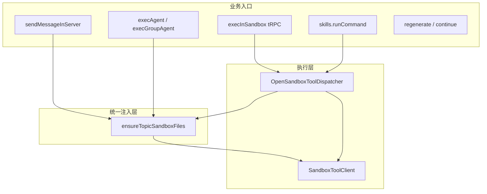
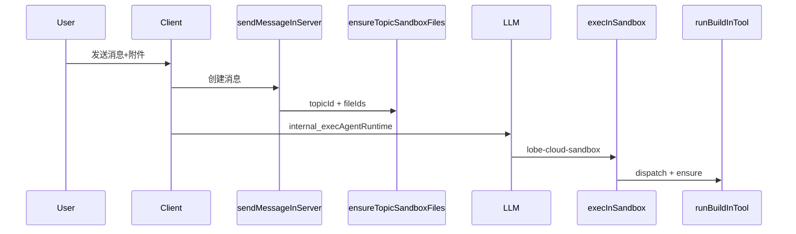

# OpenSandbox 沙箱实施计划（归档）

> 状态：已落地（Phase 0–4：dispatcher、ensure、14 工具、regenerate/continue 步前注入、serverDB 贯通）  
> 背景：Market Code Interpreter 服务不可用，需在本地用 OpenSandbox（`@ctrip/opensandbox`）覆写 `MarketSDK.plugins.runBuildInTool`。  
> 关联代码：`sandboxToolClient.ts`、`preInjectSandboxFiles.ts`、`market/index.ts`、`routers/tools/market.ts`  
> 大文件聊天方案：`packages/utils/src/fileSandboxPolicy.ts`、`lobe-file-reading` Builtin Skill（`activateSkill` 按需加载）等（已部分实现）

---

## 1. 目标

1. 按 **toolName** 完整实现 `runBuildInTool`，返回结构与 `CloudSandboxExecutionRuntime` 期望的 `data.result` 一致。
2. **统一文件注入**：发送消息与工具执行共用 `ensureTopicSandboxFiles`，避免「已有 topic 不注入」与路径不一致。
3. 覆盖 Cloud Sandbox 全部 API（14 个 toolName）。
4. **executeCode** 走 session 级沙箱执行，避免裸 `python3 -c` 拼接。
5. 可观测性、预注入失败可感知；移除调试用 `debugger`、硬编码密钥改环境变量。

---

## 2. 架构



### 2.1 建议目录结构

| 路径 | 职责 |
|------|------|
| `openSandbox/types.ts` | `RunBuildInToolContext`、各工具 result 类型 |
| `openSandbox/ensureTopicSandboxFiles.ts` | 统一注入（可吸收 `preInjectSandboxFiles.ts` 主逻辑） |
| `openSandbox/dispatcher.ts` | `dispatchOpenSandboxTool(toolName, params, context)` |
| `openSandbox/handlers/*.ts` | 按 toolName 或 file/shell/code 分组实现 |
| `openSandbox/shell.ts` | 路径转义、`sh -c`、JSON 解析辅助 |
| `market/index.ts` | 薄包装：`runBuildInTool` → dispatcher |

---

## 3. 统一文件注入（`ensureTopicSandboxFiles`）

### 3.1 接口（建议）

```typescript
interface EnsureTopicSandboxFilesParams {
  topicId: string;
  fileIds?: string[];           // 本条消息附件
  fileService: FileService;
  messageModel?: MessageModel;
  sandboxClient?: SandboxToolClient;
  skipExisting?: boolean;       // 默认 true，复用 ensureFilesInjected 去重
}

interface EnsureTopicSandboxFilesResult {
  injectedCount: number;
  sessionReused: boolean;
  files: RunCommandFileInput[];
}
```

### 3.2 解析顺序

1. 若 `fileIds?.length` → `resolveSandboxFileInputs(fileIds, fileService)`（已有）。
2. 否则 `messageModel` + `topicId` → **`collectSandboxFileIdsFromTopic`**：扫描 topic 内**所有** user 消息的 `fileList`，去重后按 `shouldProcessFileInSandbox` 过滤（优于仅「最近一条 user 消息」）。
3. `sandboxClient.ensureFilesInjected(topicId, files)`。
4. 失败：记录日志，**不阻断发消息**；可选错误码 `SANDBOX_INJECT_FAILED` / `SANDBOX_S3_NOT_CONFIGURED`。

### 3.3 沙箱路径约定

- 目录：`/mnt/user-data/uploads`
- 文件名：`{fileId}_{sanitizedName}`（见 `getSandboxUploadPath`）
- 与 `fileReadingSkillContent`、预注入 destination 保持一致。

### 3.4 需修改的文件

| 文件 | 改动 |
|------|------|
| `preInjectSandboxFiles.ts` | 主逻辑迁至 `ensureTopicSandboxFiles`；保留 `preInjectSandboxFiles` 薄封装 |
| `market/index.ts` | dispatcher 入口调用 ensure（需 `userId` + DB 工厂注入 `FileService` / `MessageModel`） |
| `routers/tools/market.ts` | 去掉与 dispatcher 重复的 topic 兜底，或仅做 `params.files` normalize |
| `services/sandbox/index.ts` | 同上 |
| `routers/lambda/aiChat.ts` | 创建 user message 后 `ensureTopicSandboxFiles` |
| `services/aiAgent/index.ts` | 同上；**`execGroupAgent` 将 `files` 传入 `execAgent`** |
| `services/aiAgent/index.ts` `execGroupAgent` | `execAgent` 支持 DB `fileId[]`（与 URL 上传 `files` 区分） |

### 3.5 注入时机（双保险）

| 时机 | 说明 |
|------|------|
| 发消息后 | A/B 入口：`fileIds` + topic 历史 sandbox 文件 |
| 每次 `runBuildInTool` | 幂等 `ensureFilesInjected`，已注入路径跳过 |

---

## 4. 按 toolName 实现 `runBuildInTool`

### 4.1 Handler 标准流程

1. `sessionId = context.topicId ?? context.userId ?? 'default'`
2. `await ensureTopicSandboxFiles(...)`
3. 调用 `SandboxToolClient`（`acquireSessionSandbox`）
4. 返回 `RunBuildInToolsResponse`，`data.result` 对齐 Runtime

### 4.2 工具矩阵

| toolName | 实现方式 | `data.result` 关键字段 |
|----------|----------|------------------------|
| `runCommand` | `client.runCommand`；`background` 用 nohup + session 记录 `commandId` | `stdout`, `stderr`, `exitCode`, `output`, `commandId?` |
| `executeCode` | session 版 `executeCodeInSession`（勿在 index 里拼 shell） | 同上或 `{ stdout, stderr, exitCode }` |
| `exportFile` | `curl --upload-file`（`uploadUrl` 由上层提供） | `{ success, error? }` |
| `listLocalFiles` | `find` / `ls` + 解析 JSON | `{ files: [{ name, isDirectory }] }` |
| `readLocalFile` | `sandbox.files.readFile`；行范围用 `sed -n` | `{ content, totalLines? }` |
| `writeLocalFile` | `sandbox.files.writeFiles` + 可选 `mkdir -p` | `{ bytesWritten?, success }` |
| `editLocalFile` | sed / Python 替换 | `{ replacements, linesAdded?, linesDeleted?, diffText? }` |
| `moveLocalFiles` | 逐条 `mv` | `{ results, successCount }` |
| `renameLocalFile` | `mv` | `{ newPath, success, error? }` |
| `globLocalFiles` | `find -path` 或 Python glob | `{ files, totalCount }` |
| `grepContent` | `grep -rn` / `rg` | `{ matches, totalMatches }` |
| `searchLocalFiles` | `find` + name/mtime 过滤 | `{ results, totalCount }` |
| `getCommandOutput` | session `backgroundJobs` 增量读 stdout | `{ newOutput, running, error? }` |
| `killCommand` | `kill <pid>` | `{ success, error? }` |

### 4.3 `SandboxToolClient` 待补齐

| 能力 | 说明 |
|------|------|
| `executeCode` / `runCommand` 走 **session** | 当前 `executeCode()` 用 `getSandbox()` 单例，与 `topicId` session 不一致 |
| **后台任务** | `SandboxSessionEntry.backgroundJobs: Map<commandId, …>` |
| 封装 `readSandboxFile` / `listDirectory` | 供多 handler 复用 |
| `params.files` 归一化 | dispatcher 入口统一为 `RunCommandFileInput[]` |

### 4.4 `runBuildInTool` 注入 DB 依赖（推荐方案 A）

```typescript
createOpenSandboxRunBuildInTool({
  getSandboxClient,
  createFileService: (userId) => new FileService(serverDB, userId),
  createMessageModel: (userId) => new MessageModel(serverDB, userId),
});
```

`context.userId` 由 `execInSandbox` 等调用方传入。

---

## 5. 实施优先级

### P0（主路径）

- `runCommand`、`executeCode`、`exportFile`、`readLocalFile`、`listLocalFiles`

### P1（大文件 SKILL 常用）

- `grepContent`、`globLocalFiles`、`writeLocalFile`、`editLocalFile`

### P2（编辑 / 后台）

- `searchLocalFiles`、`moveLocalFiles`、`renameLocalFile`、`getCommandOutput`、`killCommand`

---

## 6. 业务入口清单

「入口」= 会创建消息和/或调用沙箱的路径。实施时需逐条验收 **ensure** 与 **runBuildInTool**。

| ID | 入口 | 创建 user 消息 | 当前 preInject | Plan ensure | 到 runBuildInTool |
|----|------|----------------|----------------|-------------|-------------------|
| A | 单 Agent `sendMessageInServer` | ✅ | 仅本条 `files` | fileIds + topic 全量 | 随后 client runtime → D |
| B | `execAgent` | ✅ | 有 fileIds 时 | 同 A | server tools → D |
| C | Group `execGroupAgent` | ✅ | ❌ files 未传 execAgent | 修 C | D |
| D | `execInSandbox` tRPC | ❌ | 仅 handler 兜底 | dispatcher 内 ensure | ✅ 主路径 |
| E | `ServerSandboxService` | ❌ | 同 D | 合并到 dispatcher | D |
| F | Skills `runCommand` | ❌ | ❌ | dispatcher ensure | D |
| G | `regenerateUserMessage` | ❌ | ❌ | ✅ AgentRuntime 步前 ensure | client → server runtime |
| H | `continueGenerationMessage` | ❌ | ❌ | ✅ 同 G | client → server runtime |
| I | `exportFile` 导出流 | ❌ | ❌ | 按 path 导出 | `exportFile` |
| J | `onlyAddUserMessage` | ✅ | 有 files 时应 inject | ✅ | 不调工具 |
| K | `/newTopic` 从旧 topic 分叉 | ✅ 新 topic | 仅本条 files | 新 topicId ensure | 同 A |



---

## 7. 与大文件聊天方案的关系（已实现 / 部分）

| 环节 | 状态 | 说明 |
|------|------|------|
| `fileSandboxPolicy`（>20KB） | ✅ | 跳过 `parseFileContent` |
| `MessageModel` sandbox 模式 | ✅ | 不内联 `content`，带 `sandboxPath` |
| `lobe-file-reading` Builtin Skill | ✅ | `<available_skills>` 元数据 + `activateSkill("File Reading")` 加载全文 |
| `preInjectSandboxFiles` | ⚠️ | 入口与条件过窄，待合并到 ensure |
| `forceCloudSandbox` | ✅ | client/server 临时启用工具 |
| `runBuildInTool` 全工具 | ✅ | `openSandbox/dispatcher` + `handlers.ts` |
| `ensureTopicSandboxFiles` | ✅ | topic 全量 user 附件 + dispatcher 双保险 |
| Group `execGroupAgent` 传 files | ✅ | `attachmentFileIds` → `execAgent` |

---

## 8. 实施阶段

| Phase | 内容 | 状态 |
|-------|------|------|
| 0 | 删 `debugger`、API key 仅 env、定义 result 类型表 | ✅ |
| 1 | dispatcher + P0 handlers + `executeCodeInSession` | ✅ |
| 2 | `ensureTopicSandboxFiles` + 改 A/B/C + dispatcher 工厂 | ✅ |
| 3 | P1/P2 handlers + backgroundJobs + 参数对齐 CloudSandbox types | ✅ |
| 4 | G/H `AgentRuntimeService` 步前 ensure + serverDB 贯通 + 单测 | ✅ |

**合计约 6–9 人日**（视联调而定）。

---

## 9. 验收标准

1. 已有 topic：首条消息上传 >20KB PDF，第二条纯文字，模型 `runCommand('pdftotext …')` 可读沙箱文件。
2. 14 个 toolName 在 `execInSandbox` 下各至少 1 个冒烟用例。
3. Group 带附件：user message 有 `files`，沙箱存在 `/mnt/user-data/uploads/{fileId}_*`。
4. 同文件二次 ensure：`injectedCount: 0` 仍执行成功。
5. S3 未配置：明确错误，无静默失败。

---

## 10. 已知问题与回顾（方案不足摘要）

| 问题 | 缓解方向 |
|------|----------|
| Monkey-patch 仅支持 command 型 | 本计划 14 工具分 handler |
| `executeCode` 非 session | `executeCodeInSession` |
| 预注入只绑本条 `files` | topic 级 collect + 工具前幂等 ensure |
| Group `execGroupAgent` 丢 files | 传 fileIds + ensure |
| regenerate/continue 不 re-inject | ✅ `AgentRuntimeService.ensureTopicSandboxFilesBeforeStep` |
| Market 与 OpenSandbox 无法灰度切换 | 后续可加 `SANDBOX_BACKEND=market\|opensandbox` |

---

## 11. 环境变量与镜像

| 变量 | 说明 |
|------|------|
| `SANDBOX_DOMAIN` | OpenSandbox 服务域名 |
| `SANDBOX_API_KEY` | API Key（同时写入 `SANDBOX-API-KEY` header） |
| `SANDBOX_PROTOCOL` | `http` / `https` |
| `SANDBOX_IMAGE` | 默认 `agentark/sandbox-code-interpreter:v1.0.1` |
| `SANDBOX_TIMEOUT_SECONDS` | session idle TTL（秒） |
| `SANDBOX_HTTP_REJECT_UNAUTHORIZED` | 设为 `false` 可跳过自签 HTTPS 校验 |
| `fileEnv` S3 | `S3_ACCESS_KEY_ID` 等；仅 `s3://` 源必填，HTTP 预签名 URL 可直连 |

---

## 12. 测试建议

```bash
# 策略与 prompt（已有）
cd packages/utils && bunx vitest run --silent='passed-only' 'src/fileSandboxPolicy.test.ts'
cd packages/prompts && bunx vitest run --silent='passed-only' 'src/prompts/files/index.test.ts'
cd src/services/chat/mecha && bunx vitest run --silent='passed-only' 'filterSkillsForSandboxFiles.test.ts'

# 实施后新增
# openSandbox/handlers/*.test.ts（mock SandboxToolClient）
# execInSandbox 集成测试（mock S3 + sandbox.commands.run）
```

---

## 13. 变更记录

| 日期 | 说明 |
|------|------|
| 2026-06-02 | 初版归档：合并大文件沙箱方案回顾 + OpenSandbox runBuildInTool 重构 Plan |
| 2026-06-02 | Phase 3/4：handler 参数对齐、步前 ensure、serverDB 贯通、单测 |
